Here is the comprehensive technical architectural specification of your **Explainable Expense Analysis & Complex Receipt Understanding System**, detailing every layer, neural network topology, mathematical equation, processing algorithm, and integration mechanism for your Final Year Project thesis architecture report.

---

# 🏗️ Complete System Architecture Diagram

```mermaid
graph TD
    %% LAYER 1: INGESTION & VISION PREPROCESSING
    subgraph L1 [Layer 1: Vision Ingestion & Preprocessing Architecture]
        A[Raw Input Receipt Image] -->|RESTful File Upload| B[EXIF & Aspect-Ratio Source Classification]
        B --> C[Grayscale Transformation & Color De-saturation]
        C --> D[CLAHE: Contrast Limited Adaptive Histogram Equalization]
        D --> E[Canny Edge Detection & Contour Extraction]
        E --> F[Ramer-Douglas-Peucker Quadrilateral Approximation]
        F --> G[4-Point Homography Perspective Projective Warp]
    end

    %% LAYER 2: OPTICAL EXTRACTION
    subgraph L2 [Layer 2: PaddleOCR Optical Engine Architecture]
        G --> H[DB-Net: Differentiable Binarization Text Polygon Detection]
        H -->|Bounding Box Polygons| I[CRNN-CTC: Convolutional Recurrent Neural Network]
        I -->|Text Recognition & Confidence Score| J[Raw OCR Token List & Pixel Bounding Boxes]
    end

    %% LAYER 3: DOMAIN RECOVERY & GEOMETRIC NORMALIZATION
    subgraph L3 [Layer 3: TokenCleaner Domain Recovery & Spatial Scaling]
        J --> K[Optical Error Pattern Recovery Engine]
        K -->|e.g., NET0$ -> NET @ $| L[Domain Vocabulary Word-Boundary Disambiguation]
        L -->|e.g., BRUSSELSPROUTS -> BRUSSEL + SPROUTS| M[Proportional Character-Length Box Redistribution]
        M --> N[Universal Scale-Invariant Bounding Box Normalization 0-1000]
    end

    %% LAYER 4: MULTIMODAL TRANSFORMER INFERENCE
    subgraph L4 [Layer 4: LayoutLMv3 Multimodal Transformer Architecture]
        N --> O1[E_text: Sub-word BPE Text Embeddings]
        N --> O2[E_layout: 2D Spatial Coordinate Embeddings x0,y0,x1,y1,W,H]
        G --> O3[E_visual: Linear Patch Projections ViT-style]
        O1 & O2 & O3 --> P[Multimodal Embedding Fusion & Position Encoding]
        P --> Q[Multi-Head Self-Attention Transformers MHSA]
        Q --> R[Token Classification Head: 22 CORD Semantic Categories]
    end

    %% LAYER 5: SPATIAL CLUSTERING & DOMAIN HEURISTICS
    subgraph L5 [Layer 5: Spatial Post-Processing & Heuristic Engine]
        R --> S[Subword Pool & First-Token Word-ID Alignment]
        S --> T[Domain Rule Heuristic Overrides Engine]
        T -->|Dates, Unit Rates, Loyalty Discounts| U[Y-Axis Spatial Row Clustering Engine]
        U -->|Centroid ΔY < 28px Grouping & X_min Sorting| V[Structured Line Item LEDGER & Totals Aggregator]
    end

    %% LAYER 6: PRESENTATION & UI
    subgraph L6 [Layer 6: Digital Receipt Reconstruction UI Architecture]
        V --> W[FastAPI Asynchronous JSON REST Payload]
        W --> X[Vanilla DOM Parser & Dynamic Table Rendering]
        X --> Y[Thermal Card UI: Jagged Radial Gradient Border & Emerald Discount Banner]
    end

    L1 --> L2
    L2 --> L3
    L3 --> L4
    L4 --> L5
    L5 --> L6
```



---

# 🔬 Layer-by-Layer Deep Dive Architectural Specification

## Layer 1: Vision Ingestion & Preprocessing Architecture
When a document enters the system via the asynchronous FastAPI endpoint (`/api/v1/receipts/analyze` or `/api/v1/demo/upload`), it undergoes structural vision preparation:

### 1. Source Classification & Lighting Normalization
- **Source Classification:** An automated heuristic examines image aspect ratios and EXIF focal length metadata to classify input between mobile camera snapshots and flatbed digital scans.
- **CLAHE (Contrast Limited Adaptive Histogram Equalization):** Standard histogram equalization amplifies ambient background noise (such as shadows cast by a smartphone). Our system partitions the image into localized tiles (e.g., $8 \times 8$ pixel blocks). Within each tile, histogram redistribution is enforced subject to a clipping contrast limit ($\beta = 2.0$):
  $$g(i) = \max\left(0, \, \min\left(f(i), \, \beta\right)\right)$$
  Bilinear interpolation is applied across tile boundaries to seamlessly eradicate optical vignetting without inducing false edges.

### 2. Geometric Perspective De-warping (Homography Transform)
To correct angular trapezoidal distortion caused by casual camera framing, the system calculates an inverse projective spatial transform:
1. **Edge Extraction & Contour Filtering:** Applies Canny Edge Detection over Gaussian-smoothed images to detect sharp optical paper-to-table gradients.
2. **Polygon Approximation:** Uses the **Ramer-Douglas-Peucker** algorithm to simplify closed contour curves until an exact quadrilateral boundary ($\{ (x_k, y_k) \}_{k=1}^4$) representing the four paper corners is isolated.
3. **Homography Projective Mapping:** Calculates the $3 \times 3$ projective transformation matrix $H$ mapping the observed skewed coordinates to an orthonormal, flattened top-down target dimension ($W \times H$):
   $$\begin{bmatrix} x_{\text{flat}} \\ y_{\text{flat}} \\ 1 \end{bmatrix} = \mathbf{H} \begin{bmatrix} x_{\text{raw}} \\ y_{\text{raw}} \\ 1 \end{bmatrix} \quad \text{where} \quad \mathbf{H} = \begin{bmatrix} h_{11} & h_{12} & h_{13} \\ h_{21} & h_{22} & h_{23} \\ h_{31} & h_{32} & h_{33} \end{bmatrix}$$
   *(Note: This transform is automatically bypassed when digital scan signatures—such as SROIE evaluation data—are detected, preserving raw sensor acuity).*

---

## Layer 2: PaddleOCR Optical Extraction Engine Architecture
The flattened image is ingested by our primary optical extraction backbone, **PaddleOCR**, structured into a dual-stage decoupled deep learning architecture:

```
[Perspective Corrected Image] 
         │
         ▼
 ┌──────────────────────────────────────┐
 │ DB-Net (Differentiable Binarization) │ ──► Bounding Box Polygons (x, y)
 └──────────────────────────────────────┘
         │
         ▼ (RoiAlign Crop of Detected Polygons)
 ┌──────────────────────────────────────┐
 │      CRNN (Bi-LSTM + CTC Decode)     │ ──► Characters & Confidence Scores
 └──────────────────────────────────────┘
```

### 1. Text Region Detection (DB-Net - Differentiable Binarization)
Traditional text detectors apply arbitrary hard thresholding ($P_{i,j} > 0.5$) during binarization, which breaks down on faded supermarket thermal receipts. **DB-Net** incorporates binarization directly into the neural backpropagation optimization loop:
- A Pyramidal Backbone (ResNet/MobileNetV3) generates both a probability feature map ($P$) and a localized dynamic threshold map ($T$).
- Approximate Differentiable Binarization ($B$) is computed continuously:
  $$\hat{B}_{i,j} = \frac{1}{1 + e^{-k(P_{i,j} - T_{i,j})}}$$
  Where $k=50$ amplifies gradient convergence, ensuring high accuracy for both horizontal and rotated text boxes.

### 2. Text Recognition (CRNN-CTC)
Cropped polygon text lines are evaluated by a **Convolutional Recurrent Neural Network (CRNN)**:
- Convolutional feature maps transform 2D line images into sequence feature vectors.
- A **Bidirectional LSTM (Long Short-Term Memory)** network evaluates contextual dependencies left-to-right and right-to-left.
- **CTC (Connectionist Temporal Classification):** Resolves unsegmented alignment between continuous visual sequence frames and discrete characters by calculating sequence loss over valid path alignments across all possible character outputs and silent blurs ($\epsilon$).

---

## Layer 3: Domain Pre-Tokenization Recovery & Geometry Redistribution (`TokenCleaner`)
Raw commercial OCR outputs suffer from hardware irregularities inherent to supermarket scale printer heads and condensed thermal character tracking. Our dedicated **`TokenCleaner`** architectural layer acts as an essential pre-processing gatekeeper before semantic modeling:

### 1. Optical Error Pattern Recovery State Machine
Supermarket produce price labels consistently induce optical matrix ambiguity. Targeted automated remediation routines enforce:
- **Symbol Disambiguation:** Transforms confused numeric/symbol intersections (e.g., converting misread expressions like `NET0$2.99/kg` or `NETO$` directly into standardized `NET @ $` density identifiers).
- **Currency Inversion Correction:** Reconstructs reversed symbol sequences caused by narrow edge fonts (e.g., transforming `66.0$` $\rightarrow$ `$0.99` and restoring valid standard syntax `$X.XX`).

### 2. Word-Boundary Splitting & Proportional Bounding Box Redistribution
When thermal printer tracking condenses letter spacing, OCR detectors merge separate words into individual polygons (e.g., `BRUSSELSPROUTS` or `LETTUCEICEBERG`). Passing concatenated tokens directly to LayoutLMv3 degrades F1 scores because the pretrained vocabulary expects isolated tokens.
- `TokenCleaner` performs domain word-boundary separation using domain dictionary lookups and syntax pattern matching: `BRUSSELSPROUTS` $\rightarrow$ `["BRUSSEL", "SPROUTS"]`.
- **Mathematical Box Redistribution:** To prevent spatial loss, the original parent bounding box width ($W_{total} = X_{max} - X_{min}$) is dynamically re-allocated across the child tokens proportional to their UTF-8 character string lengths ($L_i$):
  $$w_i = \left(\frac{L_i}{\sum_{k=1}^N L_k}\right) \times W_{\text{total}}$$
  For each successive split token $i$, new spatial bounding limits are generated:
  $$X_{\min, \, i} = X_{\min, \, i-1} + w_{i-1} \quad \text{and} \quad X_{\max, \, i} = X_{\min, \, i} + w_i$$
  This ensures every decoupled word retains an absolute, geometrically truthful bounding polygon!

---

## Layer 4: LayoutLMv3 Multimodal Neural Transformer Architecture
At the core of our document understanding system lies **LayoutLMv3**, a multimodal pre-trained transformer ($135\text{M}$ parameters) that jointly reasons across text, spatial layout, and optical appearance without needing complex regional diagnostic algorithms.

```
                    ┌──────────────────────────────┐
                    │ Token Classification Output  │ ──► (e.g. menu.price, menu.nm)
                    └──────────────▲───────────────┘
                                   │  Linear Classifier Head (22 CORD BIO Classes)
                    ┌──────────────┴───────────────┘
                    │   Multi-Head Self-Attention  │ ──► Spatial Co-location Awareness
                    └──────────────▲───────────────┘
                                   │
              ┌────────────────────┼────────────────────┐
              │                    │                    │
         [E_text]             [E_layout]           [E_visual]
     Sub-word Tokens      Normalized Boxes     ViT Linear Patches
      ("ZUC", "##HINI")   ([12, 45, 120, 60])    (16x16 pixel crops)
```

### 1. Multimodal Embedding Construction
Each extracted token representation $x_i$ is built by summing three orthogonal semantic embedding layers:
$$E = E_{\text{text}}(t_i) + E_{\text{layout}}(b_i) + E_{\text{visual}}(v_i)$$
- **Textual Embedding ($E_{\text{text}}$):** Words are segmented into sub-word tokens using a Byte-Pair Encoding (BPE) tokenizer and projected into a $d_{\text{model}} = 768$ embedding space.
- **2D Spatial Layout Embedding ($E_{\text{layout}}$):** Bounding boxes are scaled to an invariant universal $1000 \times 1000$ coordinate grid:
  $$\left( x_0', \, y_0', \, x_1', \, y_1' \right) = \left( \frac{x_0 \cdot 1000}{W}, \, \frac{y_0 \cdot 1000}{H}, \, \frac{x_1 \cdot 1000}{W}, \, \frac{y_1 \cdot 1000}{H} \right)$$
  The coordinates—along with width ($w' = x_1' - x_0'$) and height ($h' = y_1' - y_0'$)—are encoded through 6 parallel embedding lookup tables and concatenated:
  $$E_{\text{layout}} = \text{Concat}\left(\text{Embed}(x_0'), \, \text{Embed}(y_0'), \, \text{Embed}(x_1'), \, \text{Embed}(y_1'), \, \text{Embed}(w'), \, \text{Embed}(h')\right)$$
- **Visual Patch Embedding ($E_{\text{visual}}$):** Adopting Vision Transformer (ViT) mechanics, the perspective-corrected receipt image is divided into a lattice of $16 \times 16$ pixel patches. A linear projection layer transforms corresponding bounding box image patches directly into unified embedding space vectors.

### 2. Multi-Head Self-Attention (MHSA) & Spatial Awareness
The unified embeddings traverse 12 Transformer encoder layers. To explicitly capture spatial relations between non-adjacent table rows, the Self-Attention calculation incorporates relative spatial distance bias terms ($\alpha_{ij}$ and $\beta_{ij}$ for relative horizontal and vertical alignment):
$$\text{Attention}(Q, K, V) = \text{Softmax}\left( \frac{Q K^T}{\sqrt{d_k}} + \alpha_{\Delta x} + \beta_{\Delta y} \right) V$$
This mathematical formulation enables a price token on the far right of a receipt to dynamically pay strong attention to an item description token located on the far left of the exact same horizontal spatial line.

### 3. Classification Head & Subword Alignment
A dense projection classification layer maps hidden representations directly to **22 sequence classification categories** (defined by our CORD dataset ontology: `menu.cnt`, `menu.nm`, `menu.price`, `total.total_price`, `sub_total.discount_price`, etc.).
- **Subword Pooling Strategy:** Because words are split into BPE subtokens (e.g. `ZUCHINNI` $\rightarrow$ `ZUCH` + `##IN` + `##NI`), during training non-primary subtokens receive loss mask target labels of `-100`. During inference, our pooling handler aligns predictions back to raw words by mapping the softmax label of the first subtoken directly to the master word.

---

## Layer 5: Spatial Post-Processing & Domain Heuristic Engine
While LayoutLMv3 achieves state-of-the-art accuracy on standard single-column restaurant invoices (CORD dataset), supermarket receipts introduce multi-column spatial complexity and out-of-distribution retail keywords. Layer 5 bridges neural outputs into clean structural schemas:

### 1. Domain Rule Heuristic Overrides Engine
To guarantee resilience against grocery-specific vocabulary distribution shifts, programmatic rule overrides enforce strict schema mapping before record assembly:
- **Date Standard Enforcement:** Any token labeled as an item code (`menu.nm` or `menu.num`) that satisfies valid numeric calendric signatures (`DD/MM/YYYY`, `YYYY-MM-DD`, `DD-MM-YYYY`, e.g., `06/01/2016`) is systematically forced to `receipt.date`.
- **Unit Density & Rate Promotion:** Tokens containing rate denominators (`/kg`, `/lb`, `/g`, `/oz`, `/ea`, `@`, `NET`) are promoted directly to `menu.unitprice` regardless of raw transformer classification.
- **Customer Savings & Loyalty Programs:** Retail discount markers (`LOYALTY`, `SAVINGS`, `PROMO`, `DISC`, or negative amounts like `-$15.00` or `($1.50)`) are re-mapped to `loyalty_discount` and `sub_total.discount_price`, routing directly to an independent `"discounts"` accounting array without polluting normal items.

### 2. Y-Axis Spatial Row Clustering Architecture
In multi-column produce invoices, evaluating tokens simply in left-to-right reading order completely scrambles quantities, item descriptions, rates, and total prices. Our system enforces **Y-Axis Spatial Row Clustering**:

```
[Row Cluster 1: Y ≈ 140px] ──► (Qty: "1")  ──► (Name: "ZUCHINNI GREEN")  ──► (Rate: "NET $5.99/kg")  ──► (Price: "$4.66")
[Row Cluster 2: Y ≈ 172px] ──► (Qty: "1")  ──► (Name: "BANANA CAVENDISH") ──► (Rate: "NET $2.99/kg")  ──► (Price: "$1.32")
```

1. **Vertical Centroid Calculation:** For all candidate tokens under `menu.*` labels, the geometric vertical midpoint is derived:
   $$Y_{\text{center}, \, i} = \frac{y_{\min, \, i} + y_{\max, \, i}}{2}$$
2. **Dynamic Row Clustering:** Tokens are evaluated in ascending vertical order. A token $j$ is assigned to an existing active row cluster $\mathcal{C}_k$ if and only if its vertical centroid distance relative to the row's running average centroid falls within an empirically established tolerance parameter ($\Delta Y < \tau$ where $\tau = 28\text{px}$):
   $$\left| Y_{\text{center}, \, j} - \frac{1}{|\mathcal{C}_k|} \sum_{m \in \mathcal{C}_k} Y_{\text{center}, \, m} \right| \le 28\text{ px}$$
   If no existing cluster satisfies this bound, a new horizontal row cluster $\mathcal{C}_{k+1}$ is instantiated.
3. **Horizontal Sorting & Field Extraction:** Within each consolidated row cluster $\mathcal{C}_k$, constituent tokens are sorted strictly by ascending horizontal starting coordinate ($X_{\min}$). The sorted sequence is parsed into structured ledger fields:
   - Leftmost numeric tokens are assigned to `quantity` (`menu.cnt`).
   - Text strings are concatenated to form clean `name` fields (`menu.nm`).
   - Rate syntax strings are isolated as `unit_price` rates (`menu.unitprice`).
   - Rightmost currency values are locked as line item `total_price` (`menu.price`).
   - *Phantom Glitch Pruning:* Any assembled row resulting in zero price values combined with non-alphabetic debris is dynamically dropped.

---

## Layer 6: Presentation & Digital Receipt Reconstruction UI Architecture
The structured aggregation engine transmits the clean payload via our RESTful asynchronous API to the browser Frontend (`/static/index.html` and `/static/demo.html`).

### 1. JSON Payload Transmission Architecture
The backend encapsulates extracted records into an interoperable schema:
```json
{
  "status": "success",
  "data": {
    "receipt_info": {
      "merchant_name": "COLES SUPERMARKET",
      "date": "06/01/2016",
      "total_amount": 10.95,
      "items": [
        {
          "quantity": "1",
          "name": "ZUCHINNI GREEN",
          "unit_price": "NET $5.99/kg",
          "total_price": 4.66
        },
        {
          "quantity": "1",
          "name": "BANANA CAVENDISH",
          "unit_price": "NET @ $2.99/kg",
          "total_price": 1.32
        }
      ],
      "discounts": [
        { "name": "LOYALTY DISCOUNT", "amount": -1.50 }
      ]
    }
  }
}
```

### 2. Digital Thermal Receipt UI Engine (`app.js` & `demo.js` + Vanilla CSS3)
Rather than displaying simple raw tables, the web application renders a state-of-the-art **Digital Receipt Reconstruction Card** (`.digital-receipt-card`) designed with high-end aesthetic engineering:

```
┌────────────────────────────────────────────────────────┐
│ 🧾  MERCHANT VENDOR (COLES SUPERMARKET)                 │
│ 📅  06/01/2016                                         │
├────────────────────────────────────────────────────────┤
│ QTY   ITEM DESCRIPTION       RATE / UNIT       AMOUNT  │
│  1    ZUCHINNI GREEN [nm]   NET $5.99/kg        $4.66  │
│  1    BANANA CAVENDISH [nm] NET @ $2.99/kg      $1.32  │
├────────────────────────────────────────────────────────┤
│ 🎁  LOYALTY DISCOUNT                           -$1.50  │  <-- (Emerald Savings Banner)
├────────────────────────────────────────────────────────┤
│ TOTAL AMOUNT DUE                               $10.95  │  <-- (Neon Typography)
└▲▼▲▼▲▼▲▼▲▼▲▼▲▼▲▼▲▼▲▼▲▼▲▼▲▼▲▼▲▼▲▼▲▼▲▼▲▼▲▼▲▼▲▼▲▼▲▼▲▼▲▼▲▼▲▼┘  <-- (Radial Gradient Thermal Tear)
```

- **Thermal Tear-off Jagged Border Formulation:** To authenticize the thermal receipt experience without external PNG image assets, a pure CSS3 repeating radial gradient constructs a simulated jagged paper tear at the bottom edge:
  ```css
  .receipt-jagged-border {
      height: 12px;
      background: linear-gradient(-45deg, transparent 6px, #111827 0), 
                  linear-gradient(45deg, transparent 6px, #111827 0);
      background-size: 12px 12px;
      background-repeat: repeat-x;
  }
  ```
- **Semantic Badging & Ledger Layout:** As JavaScript iterates the JSON items array, line item rows (`<tr>`) are generated inside a scrollable glassmorphism table container (`.table-responsive`). Each extracted produce description is augmented with semantic confidence badges (`<span class="item-badge">menu.nm</span>`), providing transparent visual validation of deep learning inference.
- **Promotional Loyalty Highlight Banner:** The UI intercepts customer savings items (`discounts` array) and reveals a dedicated emerald-tinted summary box (`.receipt-discounts`), ensuring complete auditability between raw scanned physical input and digitized financial analysis.

---
**Summary for Thesis:** This 6-layer architecture establishes an uninterrupted, highly explainable bridge between low-level optical computer vision extraction (OpenCV + PaddleOCR) and high-level multimodal transformer semantic cognition (LayoutLMv3), reinforced by specialized geometric spatial clustering and pre-token cleaning to master the domain variations of real-world expense documents.